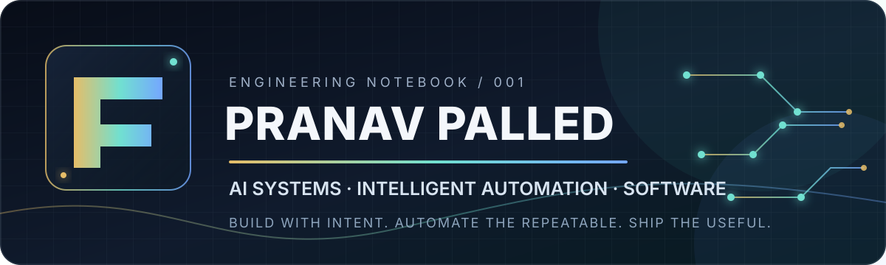

  
   
   
  
  
  
   
   
  

---

<table>
  <tr>
    <td width="58%" valign="top">
      <h2>👋 Hey, I'm Pranav.</h2>
      
<strong>Computer Science & Engineering student at KLS Gogte Institute of Technology.</strong>

      
I build practical software at the intersection of <strong>AI, machine learning, intelligent automation, and full-stack engineering</strong> — from RAG-powered knowledge assistants and AI-assisted healthcare prototypes to workflow automations and developer tools.

      
I like taking a problem from a rough idea to a working prototype: understand it, build it, test it, debug it, and improve it. This GitHub is my public engineering notebook.

    </td>
    <td width="42%" valign="top">
      <h3>🖥️ `pranav@github:~$ whoami`</h3>
      <pre>
Name      : Pranav Mahesh Palled
Degree    : B.E. — CSE
Institute : KLS Gogte Institute of Technology
Based in  : Belagavi, India
Focus     : AI • Automation • Software
Approach  : Build → Test → Iterate → Ship
      </pre>
      
Curiosity-driven. Project-oriented. Always learning.

    </td>
  </tr>
</table>

## `./mission` — What I like building

| Area | What that looks like |
|:--|:--|
| 🤖 **AI & Machine Learning** | Practical ML experiments, AI-powered applications, and intelligent tools. |
| 🧠 **Generative & Agentic AI** | LLM applications, RAG, AI agents, prompt engineering, and MCP exploration. |
| ⚙️ **Workflow Automation** | n8n workflows, API orchestration, Google Workspace integrations, and repeatable processes. |
| 💻 **Software Engineering** | Full-stack applications, backend services, databases, and developer-focused systems. |

## `./selected-builds` — Projects worth exploring

  <table>
    <tr>
      <td width="50%" valign="top">
        <h3>🧠 <a href="https://github.com/Pranav-Mahesh-Palled/CampusMind-AI">CampusMind AI</a></h3>
        
An evidence-first college knowledge assistant. Uses RAG over institutional documents and returns answers with page-level source evidence.

        <a href="https://campus-mind-ai-livid.vercel.app/">Live demo ↗</a>
      </td>
      <td width="50%" valign="top">
        <h3>🚑 <a href="https://github.com/Pranav-Mahesh-Palled/MediLink_AI">MediLink AI</a></h3>
        
An AI-assisted emergency-response prototype exploring symptom-based triage, urgency classification, and hospital recommendations.

        <a href="https://medilink-ai-vph5.onrender.com/">Live prototype ↗</a>
      </td>
    </tr>
    <tr>
      <td width="50%" valign="top">
        <h3>🌉 <a href="https://github.com/Pranav-Mahesh-Palled/triagebridge">TriageBridge</a></h3>
        
Turns free-text clinic complaints into urgency signals, red flags, and a clinician-ready handoff summary for first-level intake support.

        <a href="https://triagebridge-cc4ifljsl-nxt-wave-academy.vercel.app/">Live demo ↗</a>
      </td>
      <td width="50%" valign="top">
        <h3>⚡ <a href="https://github.com/Pranav-Mahesh-Palled/AI-Workflow-Automation-Portfolio">AI Workflow Automation Portfolio</a></h3>
        
A collection of n8n workflows connecting LLMs, Google Workspace, APIs, and AI services across productivity and content workflows.

        <a href="https://github.com/Pranav-Mahesh-Palled/AI-Workflow-Automation-Portfolio">Explore workflows ↗</a>
      </td>
    </tr>
    <tr>
      <td width="50%" valign="top">
        <h3>🧪 <a href="https://github.com/Pranav-Mahesh-Palled/ai-powered-automated-C-code-evaluation-system">AI-Powered C Code Evaluation</a></h3>
        
Automates C submission evaluation using Judge0 execution and AI-generated feedback with structured scoring.

        <a href="https://github.com/Pranav-Mahesh-Palled/ai-powered-automated-C-code-evaluation-system">View repository ↗</a>
      </td>
      <td width="50%" valign="top">
        <h3>💼 <a href="https://github.com/Pranav-Mahesh-Palled/ai-powered-linkedin-job-tracker">AI LinkedIn Job Tracker</a></h3>
        
An n8n-based workflow that tracks job posts, extracts skill requirements with AI, and organizes opportunities and application notes.

        <a href="https://github.com/Pranav-Mahesh-Palled/ai-powered-linkedin-job-tracker">View repository ↗</a>
      </td>
    </tr>
  </table>

<em>These are selected projects, not the full repository list. Browse all my work from the <a href="https://github.com/Pranav-Mahesh-Palled?tab=repositories">repositories page</a>.</em>

## `./toolkit` — Technologies I work with

**Languages**

  
  
  
  
  
  

**Web & application development**

  
  
  
  
  
  
  

**AI, automation & tools**

  
  
  
  
  
  
  
  

## `./now` — Current learning direction

- **Grounded AI:** RAG pipelines, evaluation, and source-backed answers.
- **Agentic systems:** tool-using agents, multi-step workflows, and MCP integrations.
- **Engineering fundamentals:** DSA, backend design, APIs, and reliable application architecture.

## `./experience` — Selected milestones

- 🎓 **NPTEL Winter Internship — IIT Kharagpur:** Worked on AI workflow automation and n8n-based solutions.
- ☁️ **AWS Student Builder Group — KLS GIT:** Tech Team; contributing to student cloud-learning and community initiatives.
- 🏅 **NPTEL Top 5%:** Scored **85%** in the Mobile VR & AI course.

## `./github-telemetry` — A little activity snapshot

  
  
   
  

Stats cards are generated by third-party services and may occasionally be unavailable or subject to API limits.

## `./connect` — Find me around the web

  
  
  
  
   
  
  
  
  

---

  <h3>“Ideas are easy to imagine. Engineering is turning them into something that works.”</h3>
  
<strong>BUILD WITH INTENT · AUTOMATE WITH INTELLIGENCE · KEEP ITERATING</strong>

  Thanks for stopping by. Explore a project, open an issue, or say hello.

